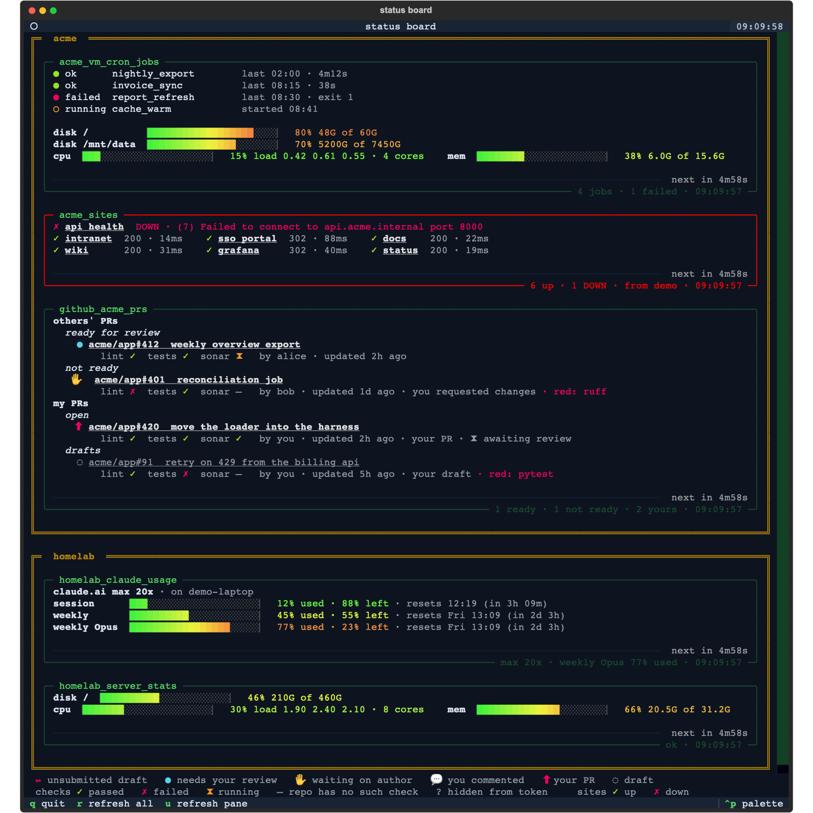

# status_board

A terminal dashboard for the workday. One long-lived
[Textual](https://textual.textualize.io/) TUI shows, in a single pane:

- remote job and cron boards, fetched over SSH (through jump hosts where
  needed), with htop-style disk, cpu and memory meters for each host;
- whether each of your sites is up, probed from wherever they are reachable;
- how much Claude allowance each machine's login has left;
- PRs waiting on you or on others, across several GitHub accounts and
  Bitbucket, with lint, tests and sonar check columns on every row.

It exists so the things that need attention across several machines,
networks and accounts sit in one terminal window instead of a dozen browser
tabs and ssh sessions. Panel definitions travel with the private repos that
own them, so there is no central registry to edit: clone a context's
credentials repo on a machine and its panels appear.



*Rendered from fake sample data.*

## Quick start

```bash
cd ~/GitHub/status_board
uv sync
uv run python src/status_board.py           # the live board
uv run python src/status_board.py --once    # one static render, no TUI (sanity check)
uv run python src/status_board.py --add     # wizard: add a new panel to a config
uv run python src/status_board.py --config path/to/statusboard.yaml  # load only this file, skip discovery
```

The TUI uses the readablecode "terminal navy" theme (shared with herdstone
via `readable-utils`). `--once` fetches every panel concurrently and prints
in config order.

## How it works

- Panels are declared in YAML configs (see
  [Where panels come from](#where-panels-come-from)). Each panel has a type,
  and each type has one fetcher.
- In the TUI every panel polls on its own `interval`, in a worker thread. A
  bar along the bottom of the panel fills toward the next poll and pulses
  while a fetch is in flight.
- Remote work (`ssh_command`, remote `http_checks`, remote `claude_usage`)
  runs over plain `ssh`, with the jump chain built from the host inventories.
  When the board runs on the target or jump machine itself, the hop or the
  ssh call is skipped.
- A panel whose fetch fails, or that finds a site down or a Claude limit at
  100%, gets a red border. Its subtitle carries a one-line summary and the
  time of the last fetch.
- A two-line key at the bottom of the board explains the PR badges and check
  marks.

## Keys

| Key | Action |
|-----|--------|
| `q` | quit |
| `r` | refresh **all** panels now |
| `u` | refresh **one** panel now: the panel under the mouse, else the focused one |
| `tab` / `shift+tab` | move focus between panels (clicking a panel also focuses it) |
| `esc` / `q` (in a log-follow pane) | back to the board |

PR titles and site names are clickable. Inside the TUI the click is handled
by the app itself (Textual owns the mouse, so terminal-native hyperlinks
don't fire) and opens the panel's `browser:` if set. For example,
`browser: edge` sends a work account's PRs to Edge while everything else
uses the OS default. Recognized names: `edge`, `chrome`, `firefox`, `safari`;
anything else is passed through as the app/binary name. In `--once` output
the titles are plain OSC 8 hyperlinks handled by the terminal (iTerm2,
WezTerm, Kitty, recent Windows Terminal), which always use the OS default
browser.

## Where panels come from

This repo is designed to be cloned **next to** one or more private
`*_credentials` repos, all under the same parent directory:

```
~/GitHub/
├── status_board/                 <- this repo (public: code + secrets-free examples)
│   └── statusboard.yaml          <- optional, tracked: SECRETS-FREE panels only
├── personal_credentials/         <- private repo
│   ├── personal_statusboard.yaml <- panel definitions for this context
│   ├── personal_hosts.json       <- host inventory (SSH targets & jump hosts)
│   └── personal.env              <- gitignored tokens the panels reference
└── acme_credentials/             <- one private repo per work context
    ├── acme_statusboard.yaml
    ├── acme_hosts.json
    └── acme.env
```

On startup the board loads, in order:

1. `statusboard.yaml` in this repo's root, if present. It is tracked in the
   public repo, so **secrets-free panels only**;
2. `<context>_statusboard.yaml` in every sibling `*_credentials` repo
   (e.g. `acme_credentials/acme_statusboard.yaml`).

`--config <file>` loads only that file and skips discovery, for testing.

A machine only shows the panels of the credentials repos it has cloned:
clone a context's credentials repo and its panels appear. Panel names must
be unique across all loaded configs.

Panels are **grouped visually by the repo they came from**: each config's
panels sit together inside a double-bordered box titled with the context
(`acme`, `personal`, ...), so one glance separates one context's world from
another's. In `--once` output the groups become heavy section rules.

Copy-paste-ready starting points for all three files live in
[`examples/`](examples/):

- [`statusboard.example.yaml`](examples/statusboard.example.yaml): every
  panel type with every option, commented;
- [`hosts.example.json`](examples/hosts.example.json): the host inventory
  schema;
- [`example.env`](examples/example.env): where tokens go (never in the yaml).

## The add-panel wizard

```bash
uv run python src/status_board.py --add
```

walks through adding a panel interactively: pick which config file it lives
in (any sibling credentials repo, where the file is created if it doesn't
exist yet, or this repo's tracked `statusboard.yaml`, flagged as public),
pick the panel type, and answer its fields. Host and jump tokens are checked
against the inventories as you type, `log_link` patterns are compile-checked,
and the final YAML is previewed before anything is written. The wizard
**appends** to existing configs, so hand-written formatting and comments are
preserved. The board picks the new panel up on next launch.

## Panel types

Every panel takes `name`, `type`, optional `interval` (seconds between
refreshes) and `note`.

| Type | Shows |
|------|-------|
| [`ssh_command`](#ssh_command-run-a-command-on-a-remote-machine-and-show-its-output) | a remote command's output, optional host meters and clickable log rows |
| [`http_checks`](#http_checks-is-each-site-up) | up/down per site, probed locally or from a remote host |
| [`claude_usage`](#claude_usage-claude-allowance-left-for-whatever-the-host-is-set-up-to-use) | Claude plan limits left, or Bedrock token totals |
| [`github_prs`](#github_prs-prs-awaiting-your-review-one-panel-per-account) | open PRs for one GitHub account, grouped, with check columns |
| [`bitbucket_prs`](#bitbucket_prs-open-prs-listing-you-as-reviewer) | the same for Bitbucket repos |

### `ssh_command`: run a command on a remote machine and show its output

```yaml
- name: acme_vm_cron_jobs
  type: ssh_command
  host: sshacmevm          # inventory name or alias
  jump: sshacme            # optional jump hop (inventory name or alias)
  command: "bash ~/scripts/job_status.sh"
  interval: 300
  timeout: 90
```

`host` and `jump` resolve against the host inventories
(`<context>_hosts.json`): the config's own credentials repo is searched
first, then every other sibling inventory. The jump hop is injected on the
command line as `ssh -J user@host:port`, so the chain lives entirely in
config + inventory (**deliberately not in any machine's `~/.ssh/config`**)
and the board behaves identically on any machine with the credentials repos
cloned. When the board runs on the jump machine itself, the hop is skipped
automatically; when the *target* is the machine the board runs on, the
command runs locally with no ssh at all. An inventory host's
`identity_file` is passed as `-i`. This chain logic lives in the shared
`readable-utils` package (git-pinned in `[tool.uv.sources]`), the same code
the herdstone repo uses, so the two can't drift.

Requirements: non-interactive key auth to every hop (connections use
`BatchMode=yes`, so a password prompt means instant failure), and
`AllowTcpForwarding` enabled on the jump host's sshd (the default; needed
because `-J` tunnels through it; this works on Windows OpenSSH Server too).
ANSI colors in the command's output are rendered as-is.

#### `host_stats`: htop-style disk / cpu / memory meters for the host

Add `host_stats: true` to any `ssh_command` panel to get htop-style
gradient meters for the host, one line per physical drive and then cpu and
memory:

```
disk /                ▕██████████████████░░░░▏  80% 48G of 60G
disk /mnt/Ext_Eight_TB ▕█████████████████████░▏  96% 7111G of 7450G
cpu ▕█░░░░…▏   4% load 0.19 0.15 0.22 · 4 cores    mem ▕███░░░…▏  13% 2.0G of 15.6G
```

Each bar fills with a smooth green-yellow-red ramp (the same scale htop
paints its meters with), and the readout is colored by how full the resource
is. The remote host emits one machine-readable line; **all rendering happens
locally**, so the meters look identical everywhere they appear: pinned under
a command panel's output (below the scroll region, so a tall cron board
never pushes them out of view), as the entire body of a stats-only panel,
and in `--once` output.

Everything comes from numbers the kernel already maintains; nothing is
installed or tracked on the host. Disks are **physical drives, not mounts**:
every `df` row is walked back to the drive it lives on (partition, LVM and
md on Linux, APFS container to physical store on macOS) and summed per
drive, so a boot ssd plus an 8T data drive is two meters, while the dozen
partitions and system volumes an OS mounts off one drive fold into that
drive's single figure. Loop devices, zram and mounted disk images are not
drives and never appear; macOS's `/System/Volumes/*` and Recovery volumes
belong to the OS and are skipped. Each drive is labeled with the shortest
mount point it carries (`/` for the boot drive) and the boot drive leads.
CPU is `/proc/loadavg` (the same 1/5/15-minute averages `top`'s header
shows, so a panel on a 5-minute `interval` reads the 5-minute column as its
per-refresh average; the cpu bar is the 5-minute load over the core
count), memory is `free -m`, with `sysctl` and `vm_stat` standing in on
macOS. Neither kernel keeps a memory average, so the `mem` figure is a
point-in-time reading at fetch. Linux and macOS hosts.

A panel can also be **stats-only**: set `host_stats: true` and omit
`command` entirely for a host that has nothing else to report:

```yaml
- name: acme_vm_stats
  type: ssh_command
  host: sshacmevm
  host_stats: true
  interval: 300
```

#### `log_link`: click a row to follow its log

An `ssh_command` panel whose rows correspond to log files (like a cron
board) can make each row clickable:

```yaml
  log_link:
    pattern: '^[●○] \S+ +(\S+)'          # first capture group = the job token
    command: "tail -n 200 -F ~/logs/{job}.log"
```

`pattern` is matched against every line of the panel's output
(multiline); the **first capture group** in each match is underlined and
made clickable in the TUI. Clicking pushes a full-screen follow pane that
runs `command` (with `{job}` replaced by the captured, shell-quoted token)
over the **same host/jump chain the panel already uses**, streaming output
live; `tail -F` keeps following across log rotation. Press `esc` or `q`
to return to the board (the remote tail is killed on exit). `--once` output
is unaffected: a terminal can't host the follow pane, so the rows stay
plain text there.

### `http_checks`: is each site up?

```yaml
- name: acme_sites
  type: http_checks
  sites:
    - name: intranet
      url: https://intranet.acme.internal/
      insecure: true            # self-signed cert
    - url: http://api.acme.internal:8000/api/health
    - name: sso portal
      url: https://portal.acme.internal/
      expect: [200, 302, 401]   # codes that count as up
  host: sshacmevm               # optional: probe from this host
  jump: sshacme                 #   through this hop
  interval: 120
```

One `curl` GET per site, body discarded, redirects **not** followed (a 3xx
to a login page means the site is up, so SSO fronts count as alive), a hard
per-site deadline (`max_time`, default 10s). A site is up when it answers
with any 2xx/3xx, or with one of its `expect` codes when that is set (e.g.
`expect: 401` for an API that demands auth on its root). Rows render as

```
✗ api health  DOWN · (7) Failed to connect to api.acme.internal port 8000 ...
✓ intranet     200 · 14ms     ✓ wiki     200 · 31ms
✓ sso portal   302 · 88ms     ✓ grafana  302 · 40ms
```

down sites first, one per line at full width so a long curl error reads in
full, then the up sites in as many columns as the panel's width fits
(filled downward, like `ls`). The layout is worked out at draw time, so the
TUI re-flows when the terminal is resized and a narrow terminal falls back
to one site per line. Each site is clickable (opens it in the panel's
`browser:` if set), the panel subtitle reads `all 3 up` or `2 up · 1 DOWN`,
and any down site flags the panel red the way a fetch error would, while
still showing every row, so the one that broke is obvious.

**Where the probe runs is the point.** With no `host`, the sites are probed
from the machine running the board, which is right for public sites.
Internal sites are usually reachable only from inside a network the board
machine isn't on, so `host` (plus an optional `jump`) moves the probe onto
that machine over the **same ssh chain an `ssh_command` panel uses**: the
board sends a single sh one-liner that curls every site and reads the
results back, so the sites are checked exactly the way their users reach
them (DNS, cert and all). A remote vantage host needs `curl` and a POSIX
shell (Linux/macOS). When the board happens to run *on* the vantage host,
the ssh hop is skipped and curl runs locally with no shell involved, so a
board on Windows works too. `timeout` (default 60s) bounds the ssh round
trip when probing remotely. `insecure: true` skips certificate verification
for a site with a self-signed or internal-CA cert.

### `claude_usage`: Claude allowance left, for whatever the host is set up to use

```yaml
- name: acme_claude_usage
  type: claude_usage
  host: sshacmelaptop       # optional: the machine whose Claude Code to report
  jump: sshacme             #   through this hop
  interval: 300
```

Reports the connection the host's Claude Code is **configured** for, read
from `~/.claude/settings.json` on that host, so switching a machine between
a claude.ai login and AWS Bedrock shows up on the next poll with nothing to
change here:

```
claude.ai max 20x · on demo-laptop
session      ▕░░░░░░░░░░░░░░░░░░░░░░▏   2% used · 98% left · resets 12:00 (in 4h 02m)
weekly       ▕██████████░░░░░░░░░░░░▏  45% used · 55% left · resets Sat 04:00 (in 20h 02m)
weekly Fable ▕█████████████████░░░░░▏  77% used · 23% left · resets Sat 04:00 (in 20h 02m)
```

- **claude.ai subscription** (Pro, Max, Team, Enterprise): one meter per
  plan limit (the 5-hour session, the weekly allowance, and each
  model-scoped weekly), with what is left and when it resets, plus usage
  credits when they are switched on. The numbers come from the
  account-metadata endpoint behind Claude Code's `/usage` screen, read with
  the host's stored login (`~/.claude/.credentials.json`, or the login
  keychain on macOS). No tokens are spent.
- **Bedrock** (`CLAUDE_CODE_USE_BEDROCK` set): pay per token, so there is
  no allowance and nothing resets. The panel shows the configured model and
  region and that host's Claude Code token totals for today and the last 7
  days, tallied from its transcripts under `~/.claude/projects`.

The probe is read-only. It never refreshes the login, because refresh tokens
rotate and a second refresher racing `claude` could strand the stored pair,
and it never touches the settings. A login whose access token has lapsed
reads as an error until `claude` next runs on that host (or something there
that already refreshes it, like a cron poller). The panel subtitle shows the
plan and its most-used limit, and the panel turns red when a limit is at
100%.

The probe is a stdlib-only script (`src/utils/claude_usage_probe.py`) piped
to `python3 -` over the same ssh chain an `ssh_command` panel uses, so the
host needs only `python3`. The login never leaves the host; only the
numbers come back. With no `host`, or when the board runs on that host, the
board's own interpreter runs it locally.

### `github_prs`: PRs awaiting your review, one panel per account

```yaml
- name: github_personal_prs
  type: github_prs
  token_env: GH_PAT_PERSONAL
  env_file: personal.env    # optional, relative to the config's repo
  interval: 180
```

Shows every open PR the account is waiting on or being waited for: three
account-wide searches (`review-requested:`, `reviewed-by:`, `author:`), so
new repos are covered automatically. Each PR's reviews are then fetched to
badge the rows:

- `✏` you have an **unsubmitted draft review**: you wrote comments but never
  clicked "Submit review", so the author cannot see them. Shown first and
  loudest because everyone is silently waiting on everyone
- `●` review requested: genuinely needs your review. When the author
  re-requests you after a changes-requested review, the PR returns here
  marked "re-requested after your changes"
- `✋` you requested changes: waiting on the author, not on you (a
  team-level request keeps a PR searchable without putting it back in your
  personal queue)
- `💬` you commented without approving/blocking and no request is pending
- `⬆` your own open PR, with the aggregate verdict of everyone else's
  reviews (`✓ approved` / `✗ changes requested` / `⧗ awaiting review`)
- `◌` draft PR: greyed, nothing to approve until it's marked ready

PRs you approved with nothing further pending are dropped.

Rows are grouped so the panel reads top-down as "what is on me":

```
others' PRs
  ready for review
    ● acme/app#412  weekly overview export
        lint ✓  tests ✓  sonar ✗   by alice · updated 2h ago · red: SonarQube Code Analysis
  not ready
    ✋ acme/app#401  debit memo reconciliation dag
        lint ✗  tests ✓  sonar –   by alice · updated 1d ago · you requested changes · red: ruff
my PRs
  open
    ⬆ acme/app#420  move the credentials loader into the harness
        lint ✓  tests ✓  sonar ✓   by you · updated 2h ago · your PR · ⧗ awaiting review
  drafts
    ◌ acme/app#91  retry on 429 from the billing api
        lint ✓  tests ✗  sonar –   by you · updated 5h ago · your draft · red: pytest
```

**others' PRs / ready for review** is exactly the set a review workflow
would review: not a draft, no failed check. **not ready** holds the rest and
says why: a failed check, your own changes-requested review the author has
not answered, or someone else's draft. **my PRs** splits on the draft flag
only. Empty groups are left out.

Every PR's head commit is checked (check runs plus legacy commit statuses on
GitHub, commit statuses on Bitbucket) and folded into three fixed columns so
they line up on every row whatever a repo runs: **lint** (ruff, isort,
black, flake8, pre-commit, mypy, eslint, prettier, anything with "lint" in
the name), **tests** (pytest, test, unit, integration) and **sonar**
(SonarQube, quality gate). Each column shows the worst of its checks: `✗`
failed, `⧗` still running (running is not red; the PR stays ready), `✓`
passed, `–` the repo runs nothing that matches, `?` the token cannot see
check runs. A failed check with no column (a docker build, a deploy) still
turns the PR red and is named in the row's `red:` list, so the board agrees
with the review workflow on what "skip, red CI" means.

A repo whose quality gate fails on every PR and is merged red anyway can be
waved through with `ignore_checks` on the panel: a failed check whose name
contains `name` (case-insensitive) in a repo whose name contains `repo`
(every repo when omitted) shows as `ignored` instead of `✗` and does not
make the PR not ready. Keep this list in the credentials repo's config,
next to the panel it belongs to:

```yaml
  ignore_checks:
    - repo: some-repo
      name: SonarQube
```

The account is whoever the token belongs to, so two accounts means two
panels with different `token_env` names. Two panels can also share ONE
account with different fine-grained tokens: the search only returns repos a
token was granted, so a client repo hosted under a personal account gets its
own panel via a single-repo PAT (which then lives in that client's
credentials repo). Add optional `search:` qualifiers (e.g.
`-repo:owner/name`) to keep an all-repos panel from overlapping a
single-repo one. Tokens resolve from the real environment first, then the
`env_file`; tokens never go in the statusboard config itself. Putting the
token in the credentials repo's env file is the intended setup: any machine
with the repo cloned gets a working board, no shell exports or gh CLI
needed.

The PAT only needs **read** access:

- fine-grained token (recommended): `Pull requests: Read` (`Metadata: Read`
  is included automatically), granted on the repos you review in (or all
  repos of the account);
- classic token: `repo` scope if any repo is private (classic has no
  read-only option); no scopes for public-only.

Org tokens must be SSO-authorized or searches silently return nothing. The
board probes for this and shows which orgs are blocked instead of quietly
rendering an empty queue.

### `bitbucket_prs`: open PRs listing you as reviewer

```yaml
- name: acme_bitbucket_prs
  type: bitbucket_prs
  workspace: some-workspace
  repos: [repo-a, repo-b]   # omit to scan every repo in the workspace (slower)
  username_env: BB_USERNAME
  app_password_env: BB_APP_PASSWORD
  env_file: acme.env
```

Auth is a Bitbucket app password (Account settings > App passwords, scopes:
Account read + Pull requests read). Bitbucket has no cross-workspace
"review requested" search, so the board queries per repo; list the repos you
care about to keep it fast. Rows use the same badges, groups and check
columns as `github_prs` (Bitbucket has no "commented" state and no
unsubmitted-draft-review state, so `💬` and `✏` never appear); checks come
from the head commit's build statuses, so a Pipelines run that posts one
status for the whole pipeline shows up by name in the `red:` list rather than
in a column. `ignore_checks` works the same way, matching `repo` against the
repo slug.

## Viewing from a personal device

The board runs wherever the credentials/keys live and you view it from
anywhere on the LAN: e.g. run it in tmux on one machine and attach from a
phone or tablet over SSH (Blink/Termius render Textual fine). Textual can
also serve any app as a web page
(`uv run textual serve "python src/status_board.py"`, needs `textual-dev`)
if a browser tab ever beats a terminal.

## Development

```bash
uv sync
uv run pytest            # unit tests - no network, no credentials needed
uv run flake8 .
uv run isort .
uv run mypy .
```

Layout:

- `src/status_board.py`: CLI, rendering and the Textual app
- `src/utils/statusboard_tools.py`: config discovery, validation and one
  fetcher per panel type
- `src/utils/claude_usage_probe.py`: the stdlib-only probe piped to a host
  for `claude_usage`
- `src/utils/wizard_tools.py`: the `--add` wizard
- `examples/`: secrets-free starting configs
